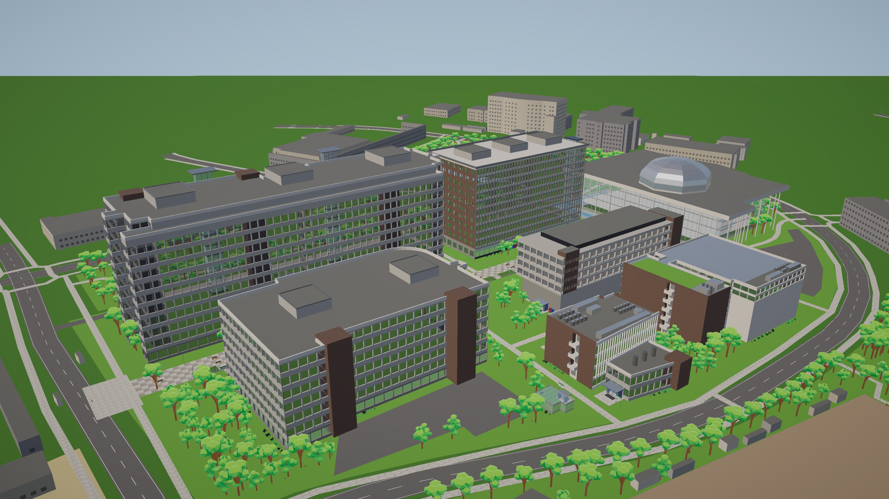
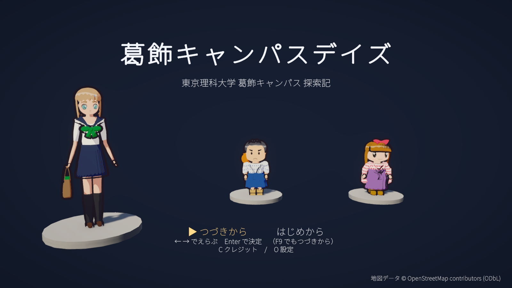
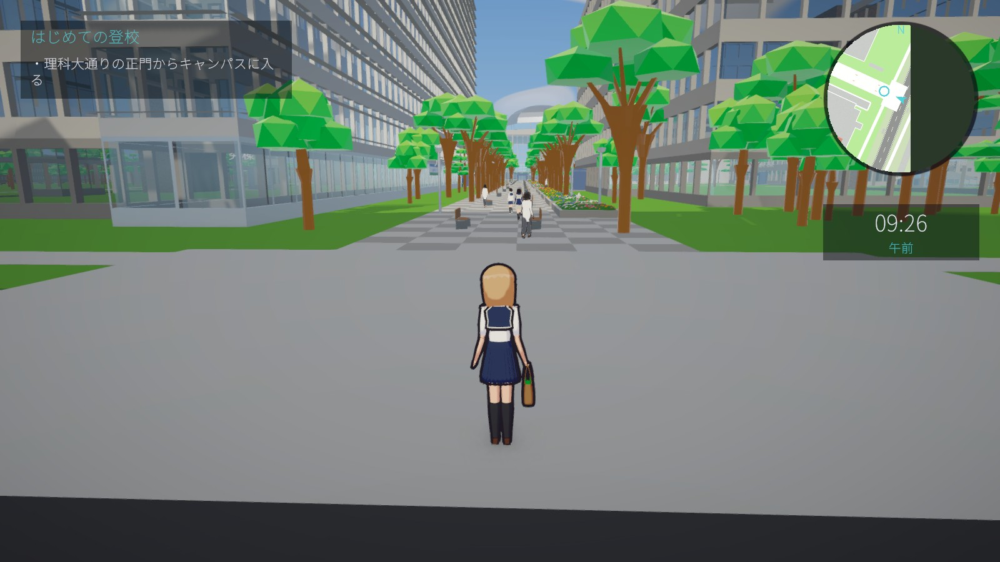
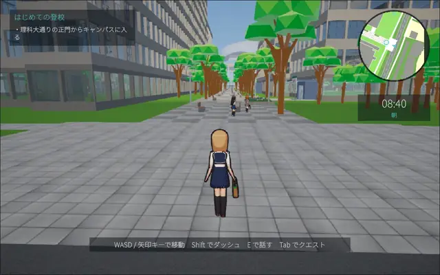
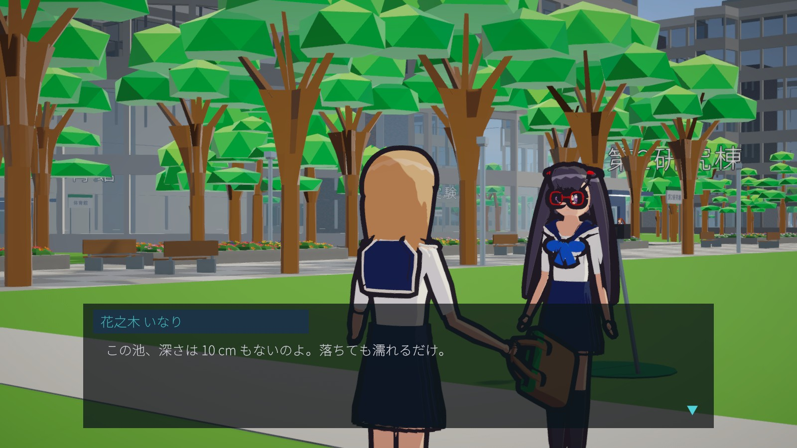
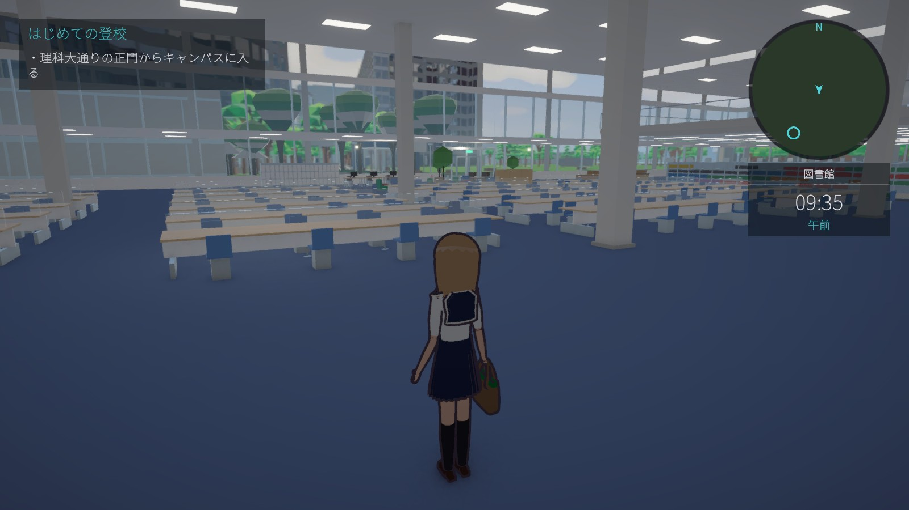
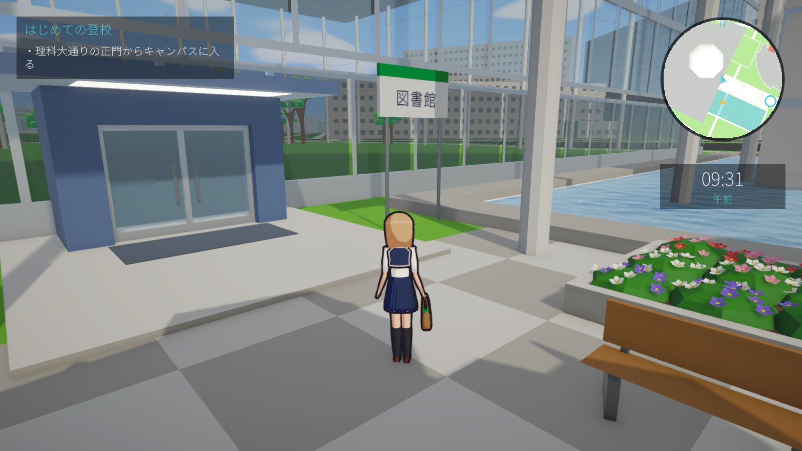
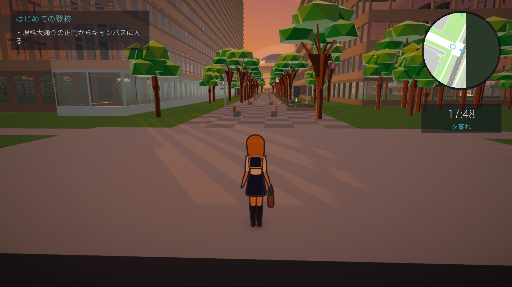

# Katsushika Campus Days（葛飾キャンパスデイズ）

東京理科大学 葛飾キャンパスを OpenStreetMap の実測フットプリントから 3D 再現し、
アニメ調の女の子（と公式マスコットのオマージュ）で歩き回る三人称探索アドベンチャー。
建物 9 棟は内部まで入れて、学生 NPC との会話でクエストが進み、1 日の終わりにリザルトが出る。





- エンジン: Unity 6 (6000.6.2f1, URP)
- アセット生成: Blender 4.5 LTS を headless Python で駆動（手作業ゼロで再生成できる）
- 音声: BGM 8 / ジングル 2 / SE 41 / 環境音 7。タイトルとキャンパスの BGM 5 曲は東京理科大学校歌（タイトルは東北きりたんの歌唱 + ピアノ伴奏、キャンパスはピアノ伴奏）。図書館のピアノの曲はショパンの夜想曲 作品 9-2 の冒頭（CC0 の録音）。ほかは numpy で合成したオリジナル
- 設計書: [docs/DESIGN.md](docs/DESIGN.md)、データ仕様: [docs/CONTENT_SPEC.md](docs/CONTENT_SPEC.md)
- 遊び方: https://takumayellow.github.io/katsushika-campus-days/howto/ （元の文書は [docs/HOW_TO_PLAY.md](docs/HOW_TO_PLAY.md)）
- 複数のエージェントで分担するときの決まり: [docs/AGENT_COORDINATION.md](docs/AGENT_COORDINATION.md)

## 遊ぶ（ブラウザ版）

https://takumayellow.github.io/katsushika-campus-days/ を開く。Chrome / Edge / Firefox の最新版、
WebGL 2 対応 GPU。初回は約 70 MB を読み込む。セーブはブラウザに 1 枠（PlayerPrefs = IndexedDB）。

## 遊ぶ（配布版）

`dist/KatsushikaCampusDays_v<版>_<commit の先頭 7 桁>_win64.zip` を展開して `KatsushikaCampusDays/KatsushikaCampusDays.exe` を起動する。
Windows 10/11 64bit、インストール不要。操作は WASD / 矢印キー移動、マウス視点、Shift ダッシュ、Space ジャンプ、
E で話す/入る、Tab クエストログ、Esc メニュー。詳細は [docs/HOW_TO_PLAY.md](docs/HOW_TO_PLAY.md)。

## 遊び方

ブラウザ版は https://takumayellow.github.io/katsushika-campus-days/ 。PC はキーボードとマウスかゲームパッドで、
スマートフォンとタブレットは画面のスティックとボタンで遊ぶ（縦持ち・横持ちのどちらでもよい、#187）。

タイトル画面で主人公を ← → か A / D で選び、Enter で決める。C でクレジット、O で設定を開く。
朝 8:30 のキャンパスから 1 日が始まり、学生や教授と話すとクエストが進み、夜にリザルト画面が出る。

操作（`Assets/Scripts/Runtime/Core/KCDInput.cs` の割り当て。ゲームパッドのボタン名は Xbox の配置）:

| 操作 | キーボード / マウス | ゲームパッド |
| --- | --- | --- |
| 移動 | W A S D / 矢印キー | 左スティック |
| 視点 | マウス移動 | 右スティック |
| ズーム | マウスホイール | なし |
| ダッシュ | Shift（押しっぱなし） | LB または LT（押しっぱなし） |
| ジャンプ | Space | A |
| 話す / 調べる / 入る / 座る | E または Enter | X |
| クエストログ | Tab | View |
| ポーズ・設定・セーブ | Esc | Menu |
| フォトモード | P（Enter / E / Space で撮る、P / Esc で戻る） | Y（A / X で撮る、Y / B で戻る） |
| 手を振る（正面の近くに人がいるとき） | Q | RB |
| 全画面とウィンドウの切り替え | Ctrl+F | なし |
| クイックセーブ / クイックロード | F5 / F9 | なし |

動作環境・既知の問題・うまく動かないときは [docs/HOW_TO_PLAY.md](docs/HOW_TO_PLAY.md) にまとめてある。
Windows の配布 zip は `python tools/package_windows.py` で作る。名前は
`dist/KatsushikaCampusDays_v<版>_<commit の先頭 7 桁>_win64.zip` で、HOW_TO_PLAY.md を README.txt、
CREDITS.md を CREDITS.txt として同梱する。地図データの帰属（© OpenStreetMap contributors, ODbL）は
タイトル画面の右下とクレジット画面に出る。



Windows 版のプレイ画面。正門からメインストリートの並木を見たところで、左上が進行中のクエスト、右上がミニマップと時刻。



ブラウザ版（画質 Medium）で正門からメインストリートを北東へ歩き、途中から Shift で走ったところ（約 7.6 秒）。
headless の Edge で `e2e/kcd_e2e/perf.py` と同じ手順でキャンパスに入り、W を押したままキャンバスを約 12 コマ/秒で撮って、640×400 のアニメーション WebP にした。

<p>




</p>

左上から順に、花之木いなりとの会話、図書館 1 階の閲覧席、図書館の入口と看板、17 時台の夕暮れのメインストリート。
どれも Windows 版を `-kcd-*` の起動引数（`SmokeDirector`）で場面を指定して起こし、1600×900 の窓で撮った。
会話の 1 枚だけはカメラをプレイヤーの斜め後ろ 4 m に置き直していて、ほかは本編の追従カメラのまま。

## 自分でビルドする

必要なもの: Unity 6000.6.2f1（Hub 版、URP テンプレート）、Blender 4.5、Python 3.11 以上（numpy・Pillow）。

```bash
# 1. 地図 → キャンパス外構 FBX（Blender）。raw_overpass.json は Overpass API の `out geom;` 出力
python tools/osm_extract.py
"/c/Program Files/Blender Foundation/Blender 4.5/blender.exe" -b --python blender/build_campus.py
"/c/Program Files/Blender Foundation/Blender 4.5/blender.exe" -b --python blender/build_characters.py
"/c/Program Files/Blender Foundation/Blender 4.5/blender.exe" -b --python blender/build_interiors.py
"/c/Program Files/Blender Foundation/Blender 4.5/blender.exe" -b --python tools/render_minimap.py

# 2. 音声（約 6 分）と、地面・外壁のテクスチャ（ambientCG から約 50 MB 落とす。焼いた jpg はリポジトリに入っている）
python tools/audio/build_audio.py
python tools/fetch_textures.py

# 3. Unity: 取り込み → シーン生成 → Windows ビルド（unity/README.md に詳細）
export UNITY='/c/Program Files/Unity/Hub/Editor/6000.6.2f1/Editor/Unity.exe'
export KCD="$(pwd -W)"
MSYS_NO_PATHCONV=1 "$UNITY" -batchmode -nographics -quit -projectPath "$KCD\unity\KatsushikaCampusDays" -logFile "$KCD\unity\logs\import.log"
MSYS_NO_PATHCONV=1 "$UNITY" -batchmode -nographics -quit -projectPath "$KCD\unity\KatsushikaCampusDays" -executeMethod KCD.Editor.SceneBuilder.BuildAll -logFile "$KCD\unity\logs\scene.log"
MSYS_NO_PATHCONV=1 "$UNITY" -batchmode -nographics -quit -projectPath "$KCD\unity\KatsushikaCampusDays" -executeMethod KCD.Editor.BuildPlayer.BuildWindows -logFile "$KCD\unity\logs\build.log"
python tools/check_unity_log.py unity/logs/import.log unity/logs/scene.log unity/logs/build.log

# 4. テストとスモーク
python tools/run_tests.py   # EditMode → PlayMode → pytest。Unity が動いていたら止まる（--wait で待つ）
python -m pytest -q         # pytest だけ（tests/, tools/, blender/kcd_lib の純 Python 部分。bpy は差し替え。数秒。pip install -r requirements-test.txt）
powershell.exe -NoProfile -ExecutionPolicy Bypass -File tools/smoke_run.ps1 -WaitSec 25 -Out docs/screenshots/smoke_title.png

# 5. 配布 zip（dist/KatsushikaCampusDays_v<版>_<commit の先頭 7 桁>_win64.zip）
python tools/package_windows.py

# 6. ブラウザ版を GitHub Pages に載せる（WebGL ビルド → Release web-latest → pages.yml）
#    unity/KatsushikaCampusDays の下と、遊び方のページの元（docs/HOW_TO_PLAY.md など）に
#    未コミットの変更があると止まる（--allow-dirty で通す）。
#    ビルド元のコミットは index.html の <meta name="kcd-build"> とページ右下に出る。
python tools/deploy_pages.py --build --smoke   # --smoke: 載せる前に build/WebGL を E2E スモーク

# 7. ブラウザ版の E2E スモーク（Playwright。初回だけ pip install -r e2e/requirements.txt）
python e2e/run_webgl_smoke.py                      # 公開版を Edge の headless + 実 GPU で、キャンパスまで
python e2e/run_webgl_smoke.py --serve build/WebGL  # ローカルのビルドを Pages と同じ条件で配信して
python -m pytest e2e                               # スモークの部品の単体テスト
```

`tools/run_tests.py` は結果を `unity/logs/tests_{editmode,playmode}.xml` と `.log` に書き、失敗とスキップの
名前・メッセージだけを抜き出して表示する。`--platform playmode`、`--filter <テスト名の正規表現>`、
`--skip-unity`（pytest だけ）が使える。batchmode が書き換える URP GlobalSettings・`ProjectSettings.asset`・
`.mat` は、実行前に変更が無かったものだけ元に戻す。終了コードは 0 = 全部通った、1 = 失敗かスキップか
ログのエラーがある、2 = 走らせられなかった、3 = 別の Unity が動いている。
PlayMode は描画のデバイスがある状態で走る。`--nographics` を付けると PlayMode も描画のデバイス無しで走り（EditMode は
いつもこちら）、撮った絵の画素を見る所と目で見るための絵を撮る所を飛ばす（飛ばしたテストはログに「描画のデバイスが無い」と
出す）。骨の位置・写真の構図と枚数などは、どちらでも確かめる。
PlayMode のテスト（`Assets/Tests/PlayMode`）は Title と Campus を読み込んで動かすので、
`SceneBuilder.BuildAll` でシーンを作り直したあとに回す。

画面に出す文字（台詞・クエスト・UI・地図の名前など）を Assets の JSON・C#・シーン・プレハブに足したら、
`python tools/make_ui_font.py` を走らせ、変わった `Assets/Fonts/KCDUIJP-Thin.ttf` をコミットする（fontTools が要る。
`requirements-test.txt` に入っている）。画面の文字のフォント（TextMeshPro の `KCD_JP` の元）は、WebGL の data を
小さくするため Windows-31J とゲームの中の字だけを持つ。作り直さずに Windows-31J の外の字（JIS 第 3・第 4 水準の漢字、
絵文字など）を足すと、画面では豆腐になり、`python -m pytest -q tools/tests/test_make_ui_font.py` が無い字を挙げて落ちる。
看板の字は Blender で焼くので、`tools/make_sign_font.py` で作る。

E2E スモーク（`e2e/`）は、読み込み時間・Build/ の応答・コンソールのエラー・キャンバスの描画・
キャンバス内の案内（`#kcd-overlay`）・Enter でのキャラ選択とキャンパス入りを確かめ、
`build/e2e/<対象>-<日時>/` に `metrics.json`（時間と wasm / JS のヒープ）とスクリーンショットを残す。
既知の警告は `e2e/kcd_e2e/console_policy.py` の許可リストに理由付きで載せる。
Pages の配信が終わると `.github/workflows/e2e-pages.yml` が GPU なし（SwiftShader）でキャラ選択まで確かめる。

Unity のライセンスは Hub でサインインしてから batchmode を使う。Unity 公式の agent skills は
`skills-lock.json` で固定してあり、`npx skills experimental_install` で `.agents/skills/` に復元できる。

## パイプライン

```
data/osm/raw_overpass.json ─ tools/osm_extract.py ─▶ data/osm/campus.json
data/osm/raw_route.json    ─ tools/osm_route.py   ─▶ data/osm/route.json（寮への道。隠しエンド #41 用）
                                                        │
blender/build_campus.py     ◀───────────────────────────┘  ─▶ unity/.../Assets/Models/Campus/*.fbx
blender/build_characters.py                                  ─▶ unity/.../Assets/Models/Characters/<id>/
blender/build_interiors.py                                   ─▶ unity/.../Assets/Models/Interiors/*.fbx + *.json
tools/audio/build_audio.py                                   ─▶ unity/.../Assets/Audio/{BGM,SE,Ambient}/*.wav
tools/fetch_textures.py                                      ─▶ unity/.../Assets/Textures/surfaces/*.jpg（ambientCG）+ tiling.json
Unity -batchmode -executeMethod KCD.Editor.SceneBuilder.BuildAll   ─▶ Scenes/{Title,Campus}.unity
Unity -batchmode -executeMethod KCD.Editor.BuildPlayer.BuildWindows ─▶ build/Windows/
```

原点と投影（敷地ポリゴン way 175463006 の重心、x = 東 m / z = 北 m）は `tools/osm_common.py` で共有していて、
`python tools/osm_common.py --selfcheck` で `data/osm/campus.json` と照合できる。
Overpass の生データ 2 つは大きいので gitignore。寮への道の分は `data/osm/route_query.ql` を投げれば取り直せる。

## フォルダ

| 場所 | 内容 |
| --- | --- |
| `blender/` | 外構・キャラ 7 体・建物内部 9 棟の生成スクリプト（`kcd_lib` / `kcd_chara` / `kcd_interior`） |
| `tools/` | OSM 抽出（キャンパス／寮への道）、ミニマップ描画、音声合成、面のテクスチャ取得、Unity ログ検査、スモーク起動、zip 化 |
| `unity/KatsushikaCampusDays/` | Unity プロジェクト。`Assets/Scripts/Editor` がシーンを組み立て、`Runtime` がゲーム本体 |
| `unity/KatsushikaCampusDays/Assets/Data/` | クエスト・会話・収集物・ローカライズ・モブ・リザルトの JSON |
| `docs/` | 設計書、データ仕様、クレジット、プレビュー画像、スクリーンショット |

## クレジット

素材ごとの出所・権利・確認状況は [docs/CREDITS.md](docs/CREDITS.md)。ゲーム内のクレジット画面も同じ内容。

- 地図データ © OpenStreetMap contributors (ODbL)。https://www.openstreetmap.org/copyright
- 地面・舗装・芝・外壁のテクスチャ: [ambientCG](https://ambientcg.com/) (CC0 1.0) の素材から作ったもの。使った素材は [docs/CREDITS.md](docs/CREDITS.md)
- 音楽: 東京理科大学校歌（作詞 佐治巌 / 作曲 大和憲史）。歌唱は東北きりたん（NEUTRINO）、ピアノ伴奏はヤマハの自動採譜（Piano Sheet Converter）を手直ししたもの。校歌の権利は未確認で、配布前に確かめる項目を CREDITS.md に並べている
- 図書館のピアノの曲: ショパン「夜想曲 作品 9-2」の冒頭の一節。演奏 Peter Johnston（Musopen、CC0。Wikimedia Commons から取得）
- 効果音・環境音・ジングルは numpy で合成したオリジナル
- 「坊っちゃん」「マドンナちゃん」は東京理科大学の公式キャラクター。本作は非公式・非営利のファンメイドで、3D モデルは独自に制作している
- フォント: Noto Sans JP（© Adobe）、Liberation Sans（© Google, Red Hat）。どちらも SIL Open Font License 1.1 で、本文は `Assets/StreamingAssets/Licenses` に同梱
- `docs/ref` の参考画像（大学の公式イラスト・鳥瞰図、日建設計の写真など）は各権利者のもので、ゲームには入っていない
